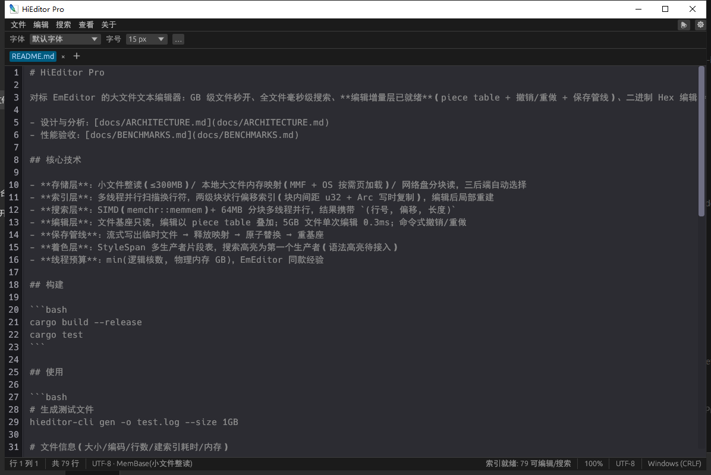
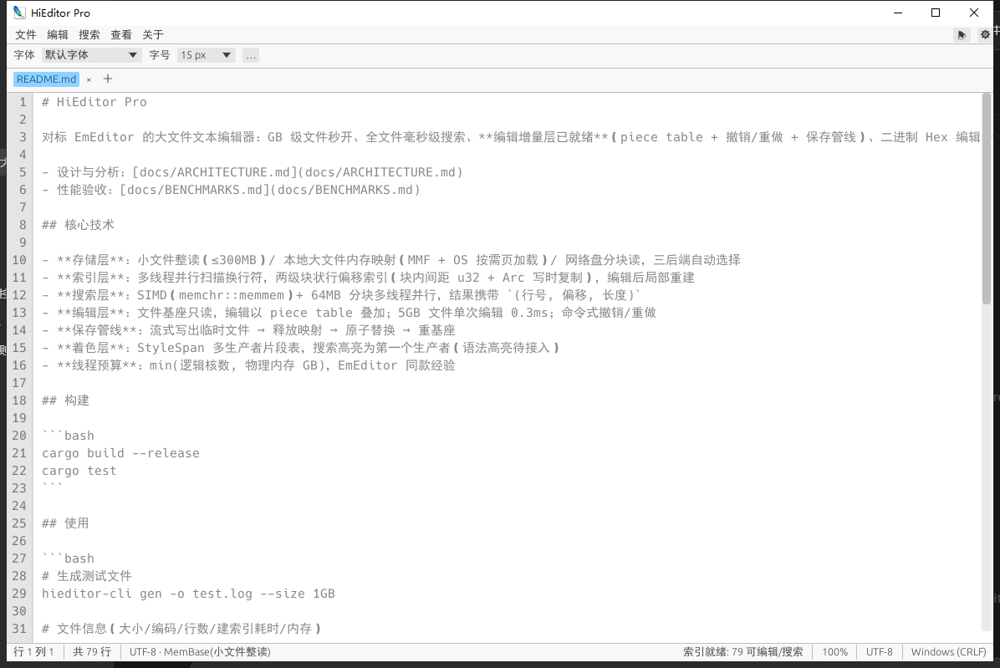

<div align="center">

# HiEditor Pro

**A GB-scale text editor for Windows — instant open, millisecond search, smooth editing.**

[简体中文](README.md) ｜ English


[](https://github.com/hicode0101/HiEditorPro/releases)


| Dark mode | Light mode |
|---|---|
|  |  |

</div>

HiEditor Pro is a large-file text editor for Windows, modeled after [EmEditor](https://www.emeditor.com/).
It combines **memory-mapped on-demand paging + a two-level blocked line index + SIMD parallel
search + a piece-table editing layer**: gigabyte files open in milliseconds, full-file search
completes in about a second, and editing cost is independent of file size — all in a single
~3 MB executable with no installer and no runtime dependencies.

Full technical analysis and measurements: [docs/ARCHITECTURE.md](docs/ARCHITECTURE.md),
[docs/BENCHMARKS.md](docs/BENCHMARKS.md).

## ✨ Features

### Large-file kernel

- **Instant open of GB-scale files**: read-only mmap base + OS on-demand paging — opening a
  5GB file takes 0 ms; the first screen renders immediately while the line index is built in
  the background with live progress
- **Two-level blocked line index**: ~4096 lines per block, u32 gaps inside blocks (auto-upgrade
  to u64 for >4GB lines), O(log n) jumps by binary search; edits rebuild only the affected
  blocks, with `Arc` copy-on-write snapshots for lock-free background access
- **SIMD parallel search**: `memchr::memmem` (AVX2) + multi-threaded scanning by line-aligned
  chunks; every hit carries `(line, byte offset, length)`; early termination at the hit cap;
  cancellable background jobs
- **Smooth editing**: piece-table incremental layer — edit latency is independent of file size
  (~0.3 ms per edit on a 5GB file); command-based undo/redo; Replace All is a single undo unit
- **Automatic storage backend selection**: whole-read for small files (≤300MB), memory mapping
  for local large files, chunked reads for network/removable drives
- **Full GBK/GB2312 support**: auto-detection, Chinese rendering, Chinese input/cursor/selection,
  encoding-aware search & replace; saving preserves the original encoding — the byte-level
  pipeline keeps the large-file architecture untouched

### GUI

- **Multi-tab**: per-tab buffer/cursor/scroll/search state, drag-to-reorder, context menu
- **Full editing**: cursor & selection (click / drag / double-click word / triple-click line /
  Shift-extend), Chinese IME, clipboard (Ctrl+C/X/V/A), undo/redo, case conversion, context menu
- **Find & Replace** (Ctrl+F / Ctrl+H): background parallel search, hit highlighting, Enter to
  step through matches, match case, whole word, single replace (incremental hit-table update,
  no rescan), Replace All (one undo unit)
- **Virtualized rendering**: only visible lines are drawn — scrolling stays smooth regardless
  of file size; word wrap and horizontal scrolling supported
- **Print** (Ctrl+P): standard Windows print dialog — All / page range / selection / current
  page; background spooling; large-range protection (20,000-page cap)
- **Custom fonts**: drop `.ttf/.otf/.ttc` into a `fonts` folder next to the exe — family names
  are parsed from the font files (including localized names)
- **Light/Dark themes**: all colors centralized in `theme.rs` for easy customization
- **Bilingual UI**: 中文 / English / follow system, persisted settings
- **File handling**: drag & drop open, recent files (persisted, 20 entries), open via command
  line, desktop-shortcut creation
- **Status bar**: line/column, line count, encoding, storage backend, indexing progress,
  dirty marker, line-ending style

### CLI (kernel acceptance tool)

`hieditor-cli` ships five subcommands to verify kernel performance directly:

| Command | Purpose |
|---|---|
| `info` | Size / encoding / line count / indexing time / memory (working set & commit) |
| `open` | Open and time jumps to arbitrary lines |
| `search` | Parallel search with ANSI highlighting, early termination at hit cap |
| `edit` | Piece-table editing demo: insert / delete / undo / redo / save-as |
| `gen` | Generate test files (realistic line lengths + configurable huge lines) |

## 🚀 Benchmarks

> Environment: i7-10750H (6C/12T), 15.8GB RAM, **5400rpm HDD**, Rust 1.98 MSVC release with
> thin LTO. Full data in [docs/BENCHMARKS.md](docs/BENCHMARKS.md).

5GB / 44.7M lines — all acceptance targets met:

| Metric | Measured |
|---|---|
| Open (mmap) | **0 ms** |
| Index + first screen (warm cache) | **0.90 s** (5.5 GB/s) |
| Full-file search (case-sensitive) | **0.71 s (7.05 GB/s)** |
| Full-file search (case-insensitive) | 1.95 s (2.57 GB/s) |
| Jump to arbitrary line + read | **3 – 16 µs** |
| Single edit (size-independent) | **~0.3 ms** |
| True process memory (commit) | **268 MB** |

> Note: the 5.17GB working set consists of mapped page-cache pages that the OS can reclaim at
> any time — not real process usage. EmEditor's FAQ addresses exactly the same accounting
> question.

## 📦 Getting started

**Requirements**: Windows 10/11 x64, Rust 1.85+ (MSVC toolchain).

```bash
git clone <repo-url>
cd HiEditorPro
cargo build --release
# Outputs: target/release/hieditor-gui.exe (GUI) and hieditor-cli.exe (CLI)
```

Alternatively grab `dist/HiEditorPro-v*.zip` (two executables + README, no installer).

## 🖥️ GUI

```bash
hieditor-gui test_5gb.log        # open from command line
hieditor-gui                     # empty window; drag a file in or press Ctrl+O
```

Key shortcuts:

| Shortcut | Action | Shortcut | Action |
|---|---|---|---|
| Ctrl+N / Ctrl+Shift+N | New tab / new window | Ctrl+F / Ctrl+H | Find / Find & Replace |
| Ctrl+O | Open file | F3 / Shift+F3 | Next / previous match |
| Ctrl+S / Ctrl+Shift+S | Save / Save as | Ctrl+Z / Ctrl+Y | Undo / redo |
| Ctrl+Alt+S | Save all | Ctrl+C/X/V/A | Copy / cut / paste / select all |
| Ctrl+P | Print | Ctrl+W | Close tab |
| Ctrl+Plus / Minus / 0 | Zoom in / out / reset | | |

Custom fonts: create a `fonts` folder next to the exe, drop in `.ttf/.otf/.ttc` files, restart,
and pick them from the font dropdown.

## ⌨️ CLI

```bash
# Generate a test file (1GB, includes three 8MB huge lines)
hieditor-cli gen -o test.log --size 1GB

# File info (size/encoding/lines/indexing time/memory)
hieditor-cli info test.log

# Timed line jumps (defaults to 0, 1/4, 1/2, 3/4, last line)
hieditor-cli open test.log

# Parallel search (ANSI highlight, early stop at 100k hits)
hieditor-cli search test.log alpha --show 20

# Piece-table edit: insert a line at line 100 and save elsewhere
hieditor-cli edit test.log --insert-line 100 --text "new line\n" --save-as out.log
```

## 🏗️ Architecture

| Crate | Responsibility |
|---|---|
| `hieditor-core` | Storage (three FileBase backends) / two-level blocked line index / EditableBuffer (piece table) / StyleSpan model |
| `hieditor-search` | Chunked multi-threaded search (SIMD memmem), cancellable background jobs |
| `hieditor-cli` | Kernel acceptance tool: info / open / search / edit / gen |
| `hieditor-gui` | egui interface: virtualized rendering, multi-tab, find & replace, printing, themes, i18n |
| `hieditor-bench` | criterion benchmarks (mmap vs ReadFile, indexing, search) as regression guards |

Key design decisions (full reasoning in [docs/ARCHITECTURE.md](docs/ARCHITECTURE.md)):

- **MMF + on-demand paging**: physical memory stays under OS page-cache control — a mapped
  5GB file costs only 268MB of commit; page-cache pages are reclaimable at any time
- **mmap on local drives, chunked reads on network drives**: benchmarks show mmap sequential
  scanning is 2.2× faster than large-buffer ReadFile locally
- **Edits never touch the file**: all changes stack on the piece table; saving streams a temp
  file → unmaps the base → atomic rename → rebuilds the base (Windows requires unmapping
  before replacement)
- **Thread budget**: min(logical cores, RAM GB), matching EmEditor's heuristic default
- **First-screen-first**: the first 1MB is scanned and rendered immediately; the full index
  builds sequentially in the background with incremental reporting

## 🗺️ Roadmap

**Done**: read-only kernel (instant open / fast search) → editing layer (piece table,
undo/redo, atomic save) → GUI editing (cursor / selection / IME / clipboard) →
multi-tab / find & replace / printing / custom fonts / themes / i18n

**Planned**:

- [ ] Regex search (integration point reserved)
- [ ] UTF-16 / ANSI editing & search (currently detected, then read-only degraded)
- [ ] Syntax highlighting (StyleSpan multi-producer interface reserved)
- [ ] Hex / binary view (reuses the same storage–index pipeline)
- [ ] Print preview, headers & footers

## ⚠️ Known limitations

1. UTF-16 is detected but its edit path is not implemented yet (GBK/GB2312 fully supported)
2. First open on a cold (mechanical) drive is bounded by disk physics (~40MB/s) — the first
   screen still appears instantly while indexing completes in the background
3. Cross-line and regex search not yet available
4. Saving requires exclusive access to the base (wait for a running search or use Save As)
5. Windows only (Win32 API in the storage and printing layers)

## 🔧 Development

```bash
cargo test --workspace          # 41 unit tests (incl. randomized differential tests)
cargo bench -p hieditor-bench   # criterion benchmarks (256MB, test files auto-generated)
release.bat                     # build and package dist/HiEditorPro-v*.zip
```

## 📄 License

[MIT](LICENSE)
