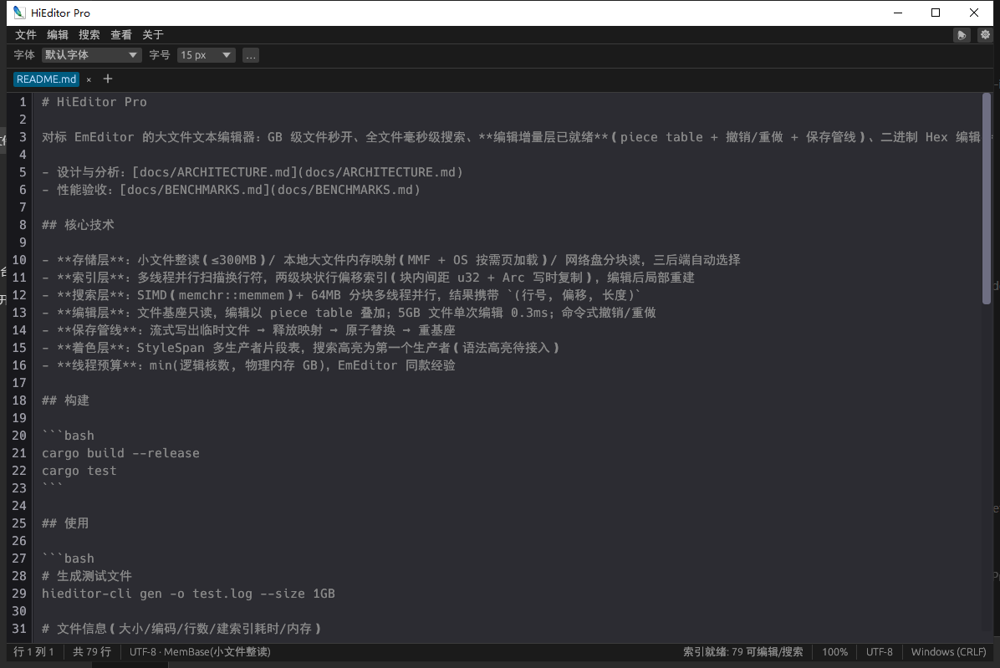
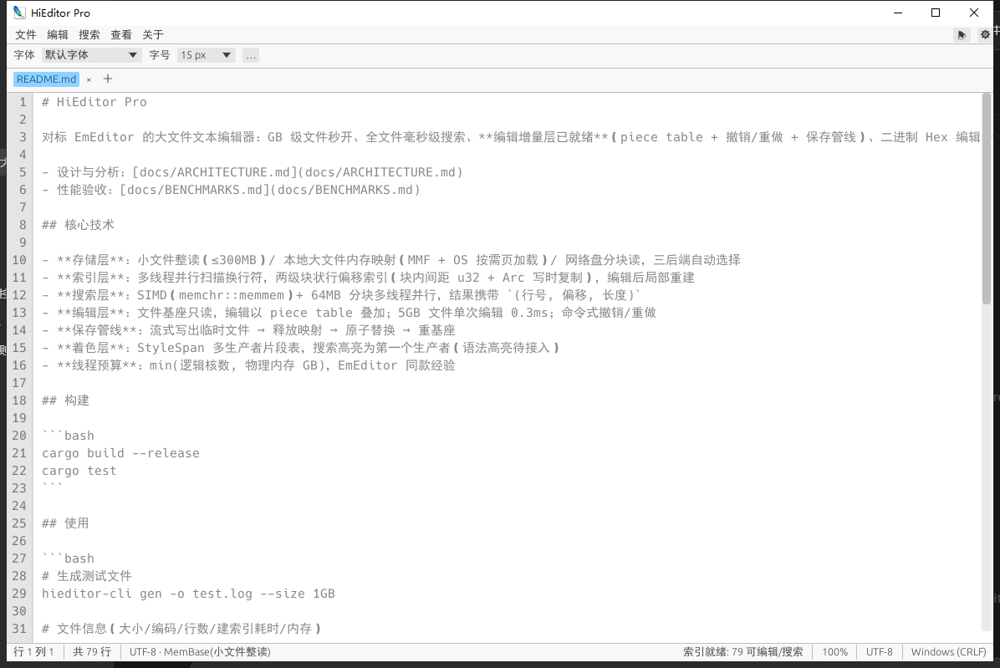

<div align="center">

# HiEditor Pro

**Windows 平台 GB 级大文件文本编辑器 — 秒开 · 毫秒级全文件搜索 · 流畅编辑**

A GB-scale text editor for Windows — instant open, millisecond full-file search, smooth editing.

简体中文 ｜ [English](README.en-US.md)


| 深色模式 | 浅色模式 |
|---|---|
|  |  |

</div>

HiEditor Pro 是一款对标 [EmEditor](https://www.emeditor.com/) 的 Windows 大文件文本编辑器：
基于 **MMF 按需页加载 + 两级块状行索引 + SIMD 并行搜索 + piece table 编辑**，
GB 级文件毫秒级打开、全文件搜索秒级完成、编辑操作与文件大小无关——
单 exe 约 3 MB，无安装、无依赖。

技术选型与实测数据的完整分析见 [docs/ARCHITECTURE.md](docs/ARCHITECTURE.md) 与 [docs/BENCHMARKS.md](docs/BENCHMARKS.md)。

## ✨ 功能特性

### 大文件内核（对标 EmEditor 核心技术）

- **秒开 GB 级文件**：mmap 只读基座 + OS 按需页加载，打开 5GB 文件 0ms（映射即返回），
  首屏立即渲染，行索引后台多线程构建，右上角实时显示进度
- **两级块状行索引**：~4096 行/块，块内 u32 间距存储（>4GB 行自动升级 u64），
  二分跳行 O(log n)；编辑后只重建受影响块，Arc 写时复制支持后台线程无锁快照
- **SIMD 并行搜索**：`memchr::memmem`（AVX2 加速）+ 按行界分块多线程扫描，
  结果携带 `(行号, 字节偏移, 长度)`，命中达上限提前终止，后台线程可取消
- **流畅编辑**：piece table 增量层，编辑耗时与文件大小无关（5GB 文件单次编辑 ~0.3ms），
  命令式撤销/重做，全部替换为整批撤销单元
- **三后端存储自动选择**：小文件整读（≤300MB）/ 本地大文件内存映射 / 网络盘与可移动介质分块读，
  按介质类型自动切换

### 图形界面

- **多标签页**：独立缓冲/光标/滚动/搜索状态，拖拽排序，右键菜单（关闭/关闭其他/复制路径…）
- **完整编辑能力**：光标与选区（点击/拖选/双击选词/三击选行/Shift 扩展）、中文输入法（IME）、
  剪贴板（Ctrl+C/X/V/A）、撤销重做（Ctrl+Z/Y）、大小写转换、右键上下文菜单
- **查找与替换**（Ctrl+F / Ctrl+H）：后台并行搜索、命中高亮、Enter 逐个跳转、
  区分大小写、全词匹配、单次替换（增量修正命中表，无需重扫）、全部替换（整批可撤销）
- **虚拟化渲染**：只绘制可视区行，滚动流畅度与文件大小无关；支持自动换行（按视觉行滚动）
  与水平滚动
- **打印**（Ctrl+P）：Windows 标准打印对话框，支持 全部/页码区间/选定内容/当前页，
  后台假脱机不卡界面，GB 级文件范围保护（上限 20,000 页）
- **自定义字体**：`fonts` 目录放入 `.ttf/.otf/.ttc` 即自动识别字体家族名（解析字体内部
  name 表，中文名可正确显示）
- **双主题**：浅色/深色模式，颜色值集中在一个文件（`theme.rs`）便于定制
- **中英双语**：界面语言 中文/English/跟随系统，设置持久化
- **文件管理**：拖放文件打开、最近文件（持久化 20 条）、命令行参数直接打开、
  创建桌面快捷方式
- **状态栏**：行列位置 / 总行数 / 编码 / 存储后端 / 索引进度 / 未保存标记 / 换行风格

### 命令行工具（内核验收）

`hieditor-cli` 提供 5 个子命令，可直接验证内核性能指标（见下方[性能实测](#-性能实测)）：

| 命令 | 功能 |
|---|---|
| `info` | 文件信息：大小/编码/行数/建索引耗时/内存占用（working set 与 commit 双口径） |
| `open` | 打开文件并计时跳任意行 |
| `search` | 并行搜索 + ANSI 关键词高亮，命中上限提前终止 |
| `edit` | piece table 编辑演示：行首插入/删除/撤销/重做/另存 |
| `gen` | 生成测试文件（真实行长分布 + 可配置超长单行） |

## 🚀 性能实测

> 环境：i7-10750H（6 核 12 线程）+ 15.8GB 内存 + **5400rpm 机械盘**，
> Rust 1.98 MSVC release + thin LTO。完整数据见 [docs/BENCHMARKS.md](docs/BENCHMARKS.md)。

5GB / 4474 万行文件，验收线全部达标：

| 指标 | 实测 |
|---|---|
| 打开（mmap 映射） | **0 ms** |
| 建索引 + 首屏可读（页缓存热） | **0.90 s**（5.5 GB/s） |
| 全文件搜索（大小写敏感） | **0.71 s（7.05 GB/s）** |
| 全文件搜索（大小写不敏感） | 1.95 s（2.57 GB/s） |
| 跳任意行 + 读取 | **3 ~ 16 µs** |
| 单次编辑（插入/删除，与文件大小无关） | **~0.3 ms** |
| 进程真实内存（commit 口径） | **268 MB** |

> 说明：5.17GB 的 working set 是映射文件的页缓存页，可被系统随时回收，不属于进程真实占用；
> EmEditor 官方 FAQ 解释的正是同一口径问题。

## 📦 获取与构建

**要求**：Windows 10/11 x64，Rust 1.85+（MSVC 工具链）。

```bash
git clone <repo-url>
cd HiEditorPro
cargo build --release
# 产物：target/release/hieditor-gui.exe（GUI）与 hieditor-cli.exe（命令行）
```

或直接使用发布包 `dist/HiEditorPro-v*.zip`（含两个 exe + README，无安装器）。

## 🖥️ GUI 使用

```bash
hieditor-gui test_5gb.log        # 命令行参数直接打开
hieditor-gui                     # 空窗口，可拖入文件或 Ctrl+O 打开
```

常用快捷键：

| 快捷键 | 功能 | 快捷键 | 功能 |
|---|---|---|---|
| Ctrl+N / Ctrl+Shift+N | 新建标签页 / 新建窗口 | Ctrl+F / Ctrl+H | 查找 / 查找替换 |
| Ctrl+O | 打开文件 | F3 / Shift+F3 | 下一个 / 上一个命中 |
| Ctrl+S / Ctrl+Shift+S | 保存 / 另存为 | Ctrl+Z / Ctrl+Y | 撤销 / 重做 |
| Ctrl+Alt+S | 全部保存 | Ctrl+C/X/V/A | 复制/剪切/粘贴/全选 |
| Ctrl+P | 打印 | Ctrl+W | 关闭标签页 |
| Ctrl+加号 / 减号 / 0 | 放大 / 缩小 / 恢复默认缩放 | | |

自定义字体：在 exe 旁新建 `fonts` 文件夹放入 `.ttf/.otf/.ttc`，重启后在字体下拉中选择。

## ⌨️ CLI 用法

```bash
# 生成测试文件（1GB，含 3 条 8MB 超长单行）
hieditor-cli gen -o test.log --size 1GB

# 文件信息（大小/编码/行数/建索引耗时/内存双口径）
hieditor-cli info test.log

# 跳行计时（缺省跳 0、1/4、1/2、3/4、最后一行）
hieditor-cli open test.log

# 并行搜索（ANSI 高亮，命中上限 10 万提前终止）
hieditor-cli search test.log alpha --show 20

# piece table 编辑：行 100 插入一行并另存
hieditor-cli edit test.log --insert-line 100 --text "new line\n" --save-as out.log
```

## 🏗️ 架构

| crate | 职责 |
|---|---|
| `hieditor-core` | 存储层（FileBase 三后端）/ 两级块状行索引 / EditableBuffer（piece table 编辑层）/ StyleSpan 着色模型 |
| `hieditor-search` | 分块多线程并行搜索（SIMD memmem），后台任务可取消、渐进汇报 |
| `hieditor-cli` | 内核验收工具：info / open / search / edit / gen |
| `hieditor-gui` | egui 编辑器界面：虚拟化渲染、多标签、查找替换、打印、主题、i18n |
| `hieditor-bench` | criterion 基准（mmap vs ReadFile、建索引、搜索），防性能回退 |

关键技术决策（详细推演见 [docs/ARCHITECTURE.md](docs/ARCHITECTURE.md)）：

- **MMF + 按需页加载**：物理内存由 OS 页缓存管理，映射 5GB 文件 commit 仅 268MB；
  页缓存页可随时被系统回收，不会挤压其他进程
- **本地盘用 mmap，网络盘降级分块读**：基准实测本地盘 mmap 顺序扫描比 ReadFile 大缓冲快 2.2×
- **编辑不落盘**：所有编辑叠加在 piece table 上，保存时流式写临时文件 → 释放映射 →
  原子替换 → 重建基座（Windows 要求先 unmap 再替换）
- **线程预算**：min(逻辑核数, 物理内存 GB)，与 EmEditor 经验式默认一致
- **首屏先行**：头部 1MB 快速扫描先行渲染，全量索引后台顺序构建并增量汇报

## 🗺️ 路线图

**已完成**：只读内核（秒开/快搜）→ 编辑增量层（piece table、撤销/重做、原子保存）→
GUI 编辑（光标/选区/IME/剪贴板）→ 多标签/查找替换/打印/自定义字体/主题/i18n

**计划中**：

- [ ] 正则搜索（regex crate 接入位已预留）
- [ ] UTF-16 / ANSI 编码的编辑与搜索（当前检测后以 UTF-8 只读降级）
- [ ] 语法高亮（StyleSpan 多生产者接口已预留）
- [ ] Hex / 二进制视图（复用同一存储-索引管线）
- [ ] 打印预览、页眉页脚

## ⚠️ 已知限制

1. 编辑/搜索仅完整支持 UTF-8/ASCII；UTF-16/ANSI 可检测但编辑路径待实现
2. 冷盘（机械硬盘）首次打开受磁盘物理 I/O 限制（~40MB/s），属硬件瓶颈；
   首屏立即显示，索引后台完成
3. 跨行搜索与正则搜索未接入
4. 保存要求基座独占（后台搜索持有时请先等搜索完成或另存）
5. 仅支持 Windows（存储层与打印使用 Win32 API）

## 🔧 开发

```bash
cargo test --workspace          # 41 项单元测试（含随机化对拍测试）
cargo bench -p hieditor-bench   # criterion 基准（256MB，自动生成测试文件）
rebuild.bat                     # 重新编译（可选跑测试）
release.bat                     # 构建并打包 dist/HiEditorPro-v*.zip
```

## 📄 协议

[MIT](LICENSE)


